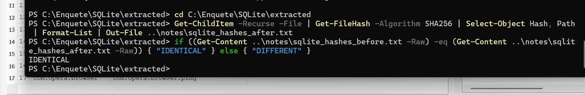
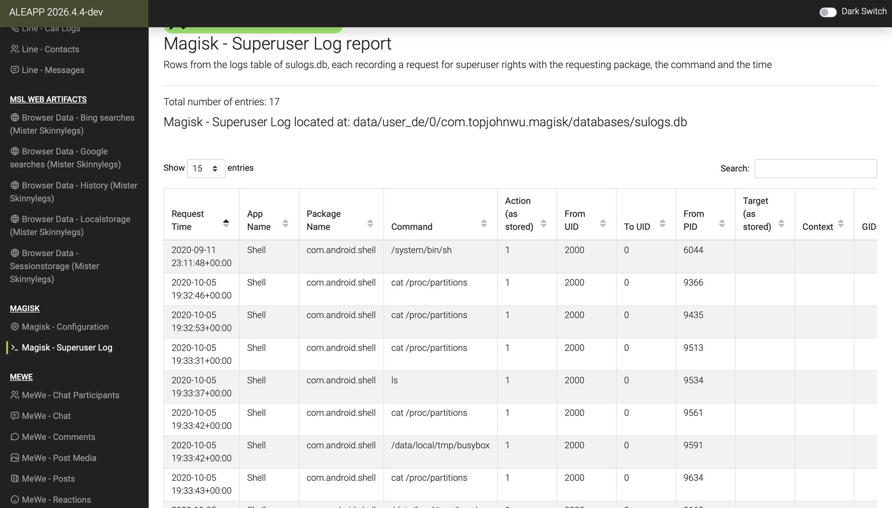
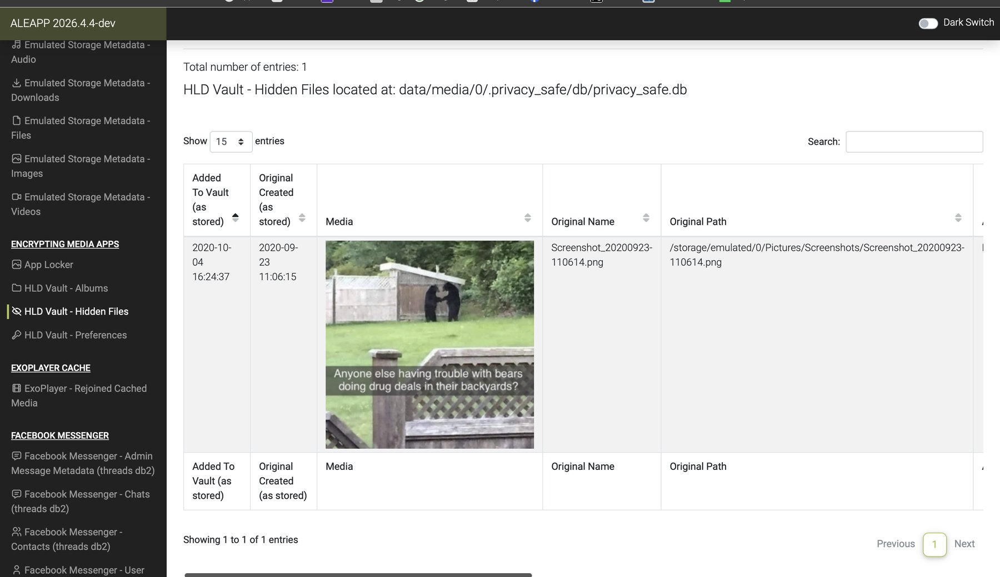
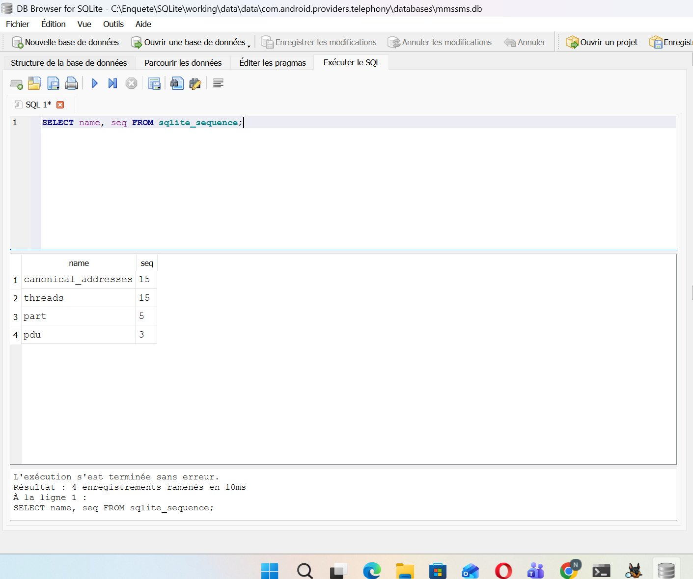
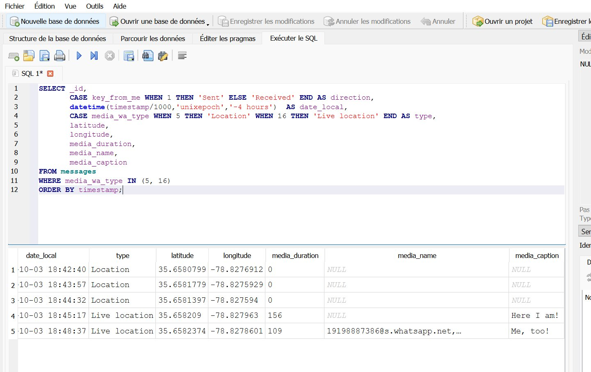

# 📱 Android 11 Forensic Investigation — Google Pixel 3

> **Summary:** Full forensic examination of a public Android 11 file-system extraction (17.2 GB, [Digital Corpora](https://digitalcorpora.org)) — from integrity verification to a consolidated timeline.
> **Key results:** evidence proven intact against its 2020 acquisition record · 7 investigation questions answered · **2 findings missed by the automated tool** (a deleted MMS and 5 WhatsApp location shares) · Python script and agents that reproduce the analysis in ~2 minutes and decrypt 10 WhatsApp backups.

*Academic project — Digital Forensics module, ENSA Tangier. Full report: [`report/Android11_Forensic_Report.pdf`](report/Android11_Forensic_Report.pdf) (41 pages).*

---

## 🎯 Scenario & questions

A company's security team suspects an employee of leaking confidential information and submits the employee's Android phone (Google Pixel 3) for forensic examination. The examiner must **preserve the evidence without altering it**, identify the device and its user, reconstruct communication activity (messages, calls, encrypted apps), determine whether files entered or left the device, detect attempts to hide data — **including whether deleted messages leave recoverable traces** — establish the user's locations, and build a timeline of key events.

| # | Question |
|---|---|
| Q1 | Which device is it, and who uses it? |
| Q2 | With whom did the user communicate, through which channels, and when? |
| Q3 | Did files enter or leave the device, and through which channels? |
| Q4 | Did the user try to hide data or activity? |
| Q5 | Where was the user? |
| Q6 | What did the user install, search and browse? |
| Q7 | In what order did the key events happen? |

## 🧾 Evidence

| Item | Value |
|---|---|
| Source | Digital Corpora — *Android 11* image (Google Pixel 3, created by Joshua Hickman, 2020) |
| File | `Android 11 - Pixel 3 - Data.tar` — 17,205,267,456 bytes |
| Type | File-system extraction of `/data` (Magnet ACQUIRE, ADB + root) |
| SHA-256 | `d4cb326a41cca5cc23a2c2cb1908498c7281b1b2fcc0f8781fb6b3945e6c815c` |

> The image is **not** included in this repository. It is publicly available from Digital Corpora for research and education. Sensitive values from the test phone (passwords, tokens, keys) are redacted in the report.

## 🛠️ Method & tools

Process aligned with **NIST SP 800-86** (collection → examination → analysis → reporting) and **ISO/IEC 27037** (preservation).

| Step | Tool | Purpose |
|---|---|---|
| 1. Preserve | `md5`, `shasum`, PowerShell `Get-FileHash` | Hashes on macOS & Windows, compared with the 2020 acquisition record |
| 2. Automated analysis | **ALEAPP** (1,317 modules) | Parse Android artifacts, trace each finding to its source file |
| 3. Manual verification | **DB Browser for SQLite** + SQL | Cross-validate ALEAPP on `mmssms.db`, `msgstore.db`, `accounts_ce.db` |
| 4. Second tool | **Autopsy 4.23.1** | Independent processing on Windows |
| 5. Automation | **Python** (standard library + `pycryptodome`) | Repeatable verification script → rule-based agent → gap explorer |

**Golden rule followed throughout:** work on copies only, hash before and after every step, confirm every result with a second method.

---

## 🔍 Key findings

### 1. Integrity proven — and a corruption caught
MD5 and SHA-1 identical to the 2020 acquisition record on two operating systems; SHA-256 unchanged before and after every tool. An external-disk disconnection produced a **truncated copy (1.05 GB instead of 17.2 GB)** — detected by the hash check *before* any analysis, then redone.



### 2. The phone recorded its own acquisition
Factory reset on 2020-09-11 22:59 UTC, **rooted with Magisk 12 minutes later** (MagiskHide enabled). On 2020-10-05, three independent sources line up: ADB key of the acquisition computer (19:32:02) → root commands of the acquisition tool in `sulogs.db` (19:32:46) → imaging (19:47:57).
➡️ *Lesson: examiner actions leave traces and must be documented so they are not mistaken for user activity.*



### 3. Concealment
Two vault apps used on 2020-10-04: a screenshot hidden in **HLD Vault**, an image hidden in **GalleryVault** and uploaded to its cloud. The file-system extraction still recovered the hidden files with their original names and paths. GalleryVault stored its PIN as an **unsalted MD5** of `1234`.



### 4. A deleted MMS — found by manual SQL, not by the tool
`sqlite_sequence` shows `pdu = 3` while only MMS 1 and 3 exist → **MMS #2 was created then deleted**. Content not recoverable (0 free pages, empty journal), but the trace of deletion is proven. This answers the scenario: deleted messages *do* leave recoverable traces, even when their content is gone.



### 5. "Empty" WhatsApp messages were location shares
ALEAPP displayed 5 WhatsApp messages as empty. Manual SQL on `msgstore.db` (`media_wa_type` 5 and 16) revealed **3 location + 2 live-location shares**, all within ~35 m, captioned *"Here I am!"* / *"Me, too!"* — a meeting being coordinated.



### Cross-validation: ALEAPP vs manual SQL
| Check | ALEAPP | Manual SQL | Match |
|---|---|---|---|
| SMS | 27 | 27 | ✅ |
| MMS | 2 | 2 | ✅ |
| Accounts | 17 | 17 | ✅ |
| WhatsApp messages | 10 | 10 (+1 internal row) | ✅ |
| Deleted MMS | not reported | MMS #2 deleted | 🆕 |
| WhatsApp 2020-10-03 | shown empty | 5 location shares | 🆕 |

---

## 🤖 Automation: from script to agent

| Version | What it does | Result on the real image |
|---|---|---|
| **v1 — script** | Re-runs the whole manual procedure: hashes, extraction, SQL checks, ALEAPP comparison, HTML/JSON report | ~2 min for 17.2 GB, same results — and **corrected one manual reading** (an orphan MMS part, not a deleted one) |
| **v2 — rule-based agent** | Observe → decide → act → record, 10 rules (hash mismatch stops, WAL text, freelist carving, sequence gaps, encrypted DBs…) | 3,866 files, 328 decisions, **10 encrypted WhatsApp backups decrypted** with the key found in the image |
| **v3 — gap explorer** | No app knowledge: finds databases the tool never read and ranks them by generic signals (timestamps, phone numbers, coordinates, gaps) | 17,751 files re-verified identical, 2,457 leads ranked for the examiner |

> Lesson from v2: fixed severity labels flagged normal WhatsApp internal-table gaps as "HIGH deletions" — a **false positive** that led to v3's data-driven scoring. Leads are proposals for the examiner, not findings.

Code and usage: [`scripts/`](scripts/). The scripts only **read** the evidence and re-hash it at the end.

```bash
pip install pycryptodome        # only needed by v2
python scripts/forensic_agent_v3.py --help
```

## ✅ Answers (summary)

| Q | Answer |
|---|---|
| Q1 | Google Pixel 3, Android 11, owner account `thisisdfir@gmail.com`; time zone UTC−4 (proven from `accounts_de.db`); reset then rooted |
| Q2 | Mainly one contact, "This Is DFIR Two", over ~12 channels (SMS/MMS, Duo, WhatsApp, Wire, Viber, Kik, Telegram, ProtonMail…) |
| Q3 | Yes — in (Discord, Imgur, Tutanota, Nearby Share) and out (MMS, messengers, ProtonMail, cloud). Channels proven; confidentiality of content not proven |
| Q4 | Yes — two vault apps, hidden root, encrypted/ephemeral messengers, a trashed Drive document, a deleted MMS |
| Q5 | Holly Springs, North Carolina — consistent across Maps, Garmin, WhatsApp and Skype |
| Q6 | Batch install of ~25 privacy/messaging apps in 10 minutes; Play Store searches for ProtonMail and Tutanota |
| Q7 | Consolidated timeline 2020-09-11 → 2020-10-05 (report, section 9) |

## ⚠️ Limitations
- File-system extraction: no unallocated space, so deleted files cannot be carved — deleted records are found only inside databases.
- Signal, Zoom, Silent Phone and 21 database files are unreadable without keys.
- Autopsy produced partial results (no SMS) — documented, which is why manual verification mattered.
- Test data: no intent is attributed to a real person.

## 💡 What I learned
- **Never trust a single tool**: manual SQL confirmed ALEAPP *and* found what it missed.
- **Hashing is not a formality**: it caught a corrupted copy before it could poison the analysis.
- **Time is evidence too**: Android stores some values in UTC and others in local time — the offset had to be proven, not assumed.
- **Even read-only opening can change files**: SQLite rewrote `msgstore.db-shm` in read-only mode — the reason to always work on copies.
- **Automation needs critical review**: my own agent produced a false positive that I had to understand and fix.

## 📂 Repository structure
```
android-forensics-pixel3/
├── README.md
├── report/        Android11_Forensic_Report.pdf (full report, 41 pages)
├── screenshots/   figures used in this README
└── scripts/       forensic_agent.py (v1), forensic_agent_v2.py, forensic_agent_v3.py + usage
```

---

`digital-forensics` · `mobile-forensics` · `android` · `aleapp` · `autopsy` · `sqlite` · `dfir` · `python`

**Author:** Naoual Wafiq — Cybersecurity Engineering Student (Cyber Defense), ENSA Tangier · [LinkedIn](https://www.linkedin.com/in/nawal-wafiq-169210227)
